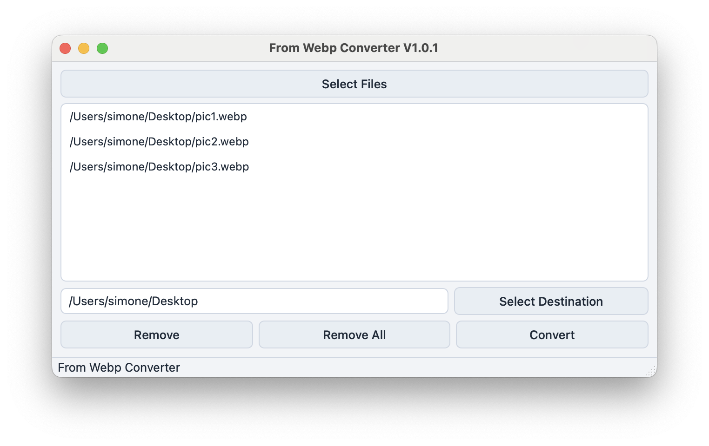

# From WebP Converter

A simple Python application to convert **WebP** images into **JPG**, **PNG**, or **GIF** formats. The application automatically detects the type of WebP image:

* **JPG** for standard photos
* **PNG** for images with transparency
* **GIF** for animated images

The program features a graphical user interface built with **PyQt6**.

## Features

* Automatic format detection (JPG, PNG, GIF)
* Drag & drop support
* Simple and user-friendly GUI
* Easy installation and usage
* Free and open-source (GPL-3.0 License)

## License

This project is licensed under the **GPL-3.0 License**. See the LICENSE file for details.

## Screenshots


## Development and updates

Requires **Python 3.11+** (Pillow 13). From the repository root:

```sh
python -m venv .venv
# Activate .venv using your platform's shell, then:
python -m pip install -r requirements.txt pytest
python src/main.py
python -m pytest -q
```

Packaged Windows/macOS apps check GitHub Releases on startup. Use **Check for
updates** to check manually. Downloading and opening an installer each require
confirmation. Conversion remains available when an update is declined.

See [update and packaging notes](docs/UPDATES.md) for the Windows installer
workflow, release asset requirements and the manual validation checklist.
The workflow produces build artifacts only; releases require explicit approval.
